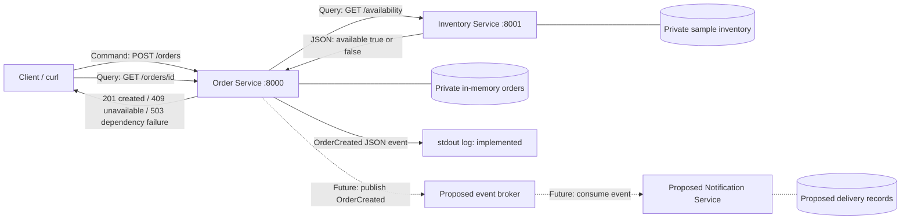
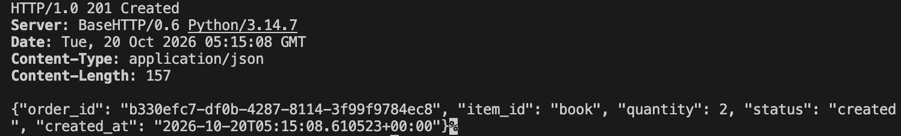
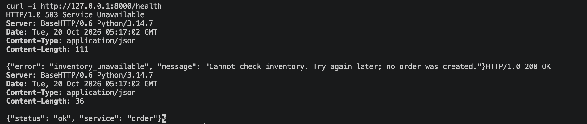
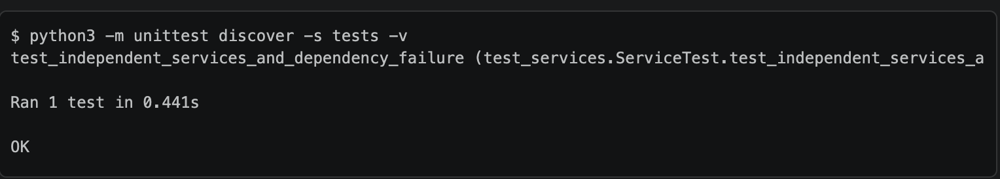

# Module 4 Assignment: Architecture & Service Boundaries

This application demonstrates an **Order Service** querying an **Inventory Service** over HTTP. Both run as independent Python processes and store their own data in memory. The design also includes a future **Notification Service**. This implementation logs an `OrderCreated` event; it does not send notifications or run a message broker.

## 1. Architecture



**Solid arrows:** implemented communication. **Dotted connections:** the proposed notification extension.

### Responsibilities and data ownership

| Component | Responsibility | Data it owns |
| --- | --- | --- |
| **Order Service** | Validate submissions, query Inventory, create orders, and provide order lookup. | Order IDs, item references, quantities, status, and creation timestamps. |
| **Inventory Service** | Determine whether enough stock is available. | Item IDs and stock quantities: `book: 5`, `pen: 0`, `notebook: 10`. |
| **Notification Service (proposed)** | React to `OrderCreated` and notify users. | Notification templates, recipient delivery details, delivery attempts, and delivery status. |

Order and Inventory keep their data in separate, private dictionaries. Order references an item by ID but accesses availability only through Inventory's HTTP API. The shared `common.py` provides HTTP helpers; it does not share service data.

### Why these boundaries?

Each component handles one business responsibility: orders, stock, or message delivery. Inventory can change its storage without changing Order as long as its API stays compatible. A future Notification Service could retry delivery independently, without delaying order creation or invalidating an accepted order.

## 2. Commands, queries, and events

| Interaction | Classification | Reason |
| --- | --- | --- |
| Check whether an item is available | **Query** | Reads availability without changing stock: `GET /availability`. |
| Create an order | **Command** | Requests a state change that may succeed or be rejected: `POST /orders`. |
| Order was created | **Event** | Reports a completed fact: `OrderCreated`, logged after the order is stored. |

Order lookup is also a query. Inventory's boolean response answers a query; it is not an event. Availability is checked synchronously so Order can immediately accept or reject the request. Notification could happen asynchronously afterward.

## 3. Setup and running the services

**Requirements:** Python 3.9+ and curl. There are no third-party Python dependencies, so no `pip install` step is needed. Run the commands below from the project folder.

### Terminal 1 — start Inventory

```sh
python3 services/inventory_service.py
```

### Terminal 2 — start Order

```sh
python3 services/order_service.py
```

Leave both terminals running. The services listen at `http://127.0.0.1:8001` and `http://127.0.0.1:8000`, respectively. Use **terminal 3** for the requests below.

<details>
<summary>Optional: use different ports</summary>

```sh
# Terminal 1
python3 services/inventory_service.py --port 9001

# Terminal 2
INVENTORY_URL=http://127.0.0.1:9001 python3 services/order_service.py --port 9000
```

Update the ports in your curl commands to match.

</details>

## 4. Successful order

With both services running, submit an order in terminal 3:

```sh
curl -i -H 'Content-Type: application/json' \
  -d '{"item_id":"book","quantity":2}' \
  http://127.0.0.1:8000/orders
```

**Result:** `201 Created`. The response includes the order ID, item, quantity, status, and creation timestamp.

### Screenshot 1 — Order created successfully



*The response confirms that Order checked availability and created an order for two books.*

### Other requests

```sh
# Check availability directly.
curl -i 'http://127.0.0.1:8001/availability?item_id=book&quantity=2'

# Request an out-of-stock item: returns 409 Conflict.
curl -i -H 'Content-Type: application/json' \
  -d '{"item_id":"pen","quantity":1}' \
  http://127.0.0.1:8000/orders

# Look up an order: replace ORDER_ID with the returned ID.
curl -i http://127.0.0.1:8000/orders/ORDER_ID
```

| Status | Meaning |
| --- | --- |
| `201 Created` | The order was created. |
| `400 Bad Request` | Invalid input; use a nonempty item ID and a positive integer quantity. |
| `404 Not Found` | The order or route does not exist. |
| `409 Conflict` | The item is unknown or has insufficient stock. |
| `503 Service Unavailable` | Inventory could not be reached or its response could not be used. |

Rejected requests do not create orders or log `OrderCreated` events.

## 5. Failure test — stop Inventory

1. Press **Ctrl+C in terminal 1** to stop Inventory.
2. Leave Order running in terminal 2.
3. Run these commands in terminal 3:

```sh
curl -i -H 'Content-Type: application/json' \
  -d '{"item_id":"book","quantity":1}' \
  http://127.0.0.1:8000/orders

curl -i http://127.0.0.1:8000/health
```

**Result:** the order request returns `503 Service Unavailable`, while Order's health endpoint returns `200 OK`.

### Screenshot 2 — Inventory unavailable; Order stays running



*With Inventory stopped, the order request returns `503 Service Unavailable`. The following health check returns `200 OK` with `{"status": "ok", "service": "order"}`, confirming that Order remains running.*

### Terminal evidence — Order remains running

The integration test stops the Inventory process and waits for it to exit before submitting another order. These excerpts show the observed results; nonessential headers are omitted:

```text
Independent processes: Order PID 90851, Inventory PID 90850

$ kill -TERM 90850  # Stop only Inventory

$ curl -i -H 'Content-Type: application/json' -d '{"item_id":"book","quantity":1}' http://127.0.0.1:57281/orders
HTTP/1.0 503 Service Unavailable

{"error": "inventory_unavailable", "message": "Cannot check inventory. Try again later; no order was created."}

$ curl -i http://127.0.0.1:57281/health
HTTP/1.0 200 OK

{"status": "ok", "service": "order"}
```

The test also retrieved an existing order during the outage. After Inventory restarted, it created another order without restarting Order.

**How failure is handled:** Order catches Inventory connection failures and timeouts and returns `503`. A two-second socket timeout limits waiting on an unresponsive dependency. The `/health` endpoint checks whether Order is running, independently of Inventory's availability.

The captured run took place on **October 19, 2026 (America/Los_Angeles)**. The test selects available ports, so its ports differ from the manual examples. See [the full integration transcript](evidence/integration.txt) for complete curl output, server logs, and events. Commands in the excerpt above omit curl's output-control flags for readability.

## 6. Automated verification

Run the integration test:

```sh
python3 -m unittest discover -s tests -v
```

The test launches separate service processes and checks:

- Successful order creation and lookup.
- Unavailable items, insufficient stock, and invalid quantities.
- Inventory shutdown and Order's `503` response.
- Order liveness and access to existing orders during the outage.
- Recovery after restarting Inventory.

It stops its own processes afterward and refreshes `evidence/integration.txt`.

### Screenshot 3 — Integration test passed



*The `OK` result confirms that the integration test passed. This one test exercises all the scenarios listed above.*

## 7. Scope and limitations

- **Availability only:** the query does not reserve or decrement stock. Repeated orders can exceed physical inventory; real checkout would require an atomic reservation command owned by Inventory.
- **In-memory storage:** orders disappear when Order restarts, and sample inventory resets when Inventory restarts.
- **Notification design only:** `OrderCreated` is logged to stdout. No notification worker, broker, or actual delivery is implemented.

A production system would also need durable storage, reliable event publication, idempotent consumers, and authentication.

## 8. Reflection

Clear service boundaries give each component a focused responsibility, making the system easier to understand, test, and change. Explicit data ownership establishes which service is authoritative and prevents other services from relying on its internal storage details. Communicating through stable APIs or events lets components evolve independently while making dependency failures visible and manageable. In this application, Inventory owns availability decisions and Order owns order records, so an Inventory outage can be reported without destroying existing orders or crashing Order.
